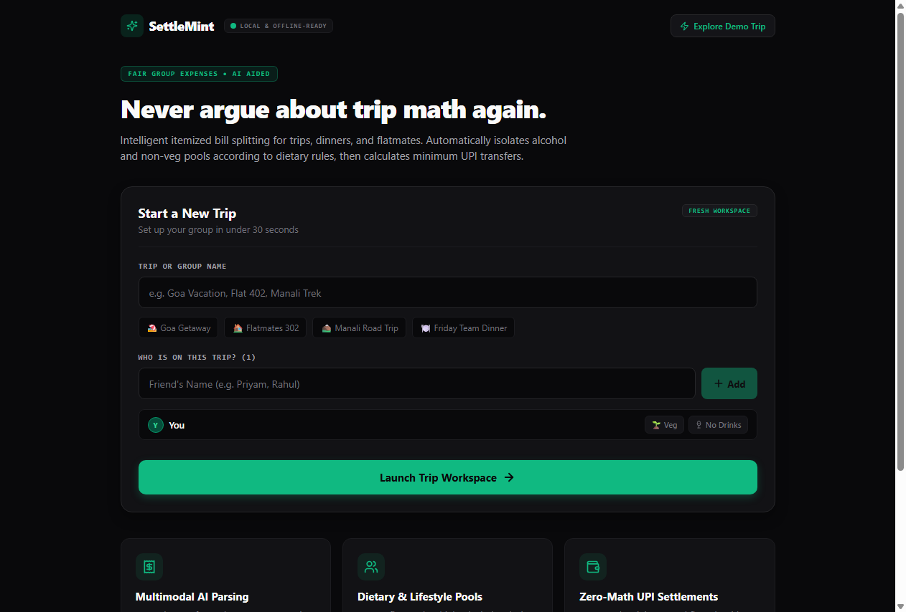
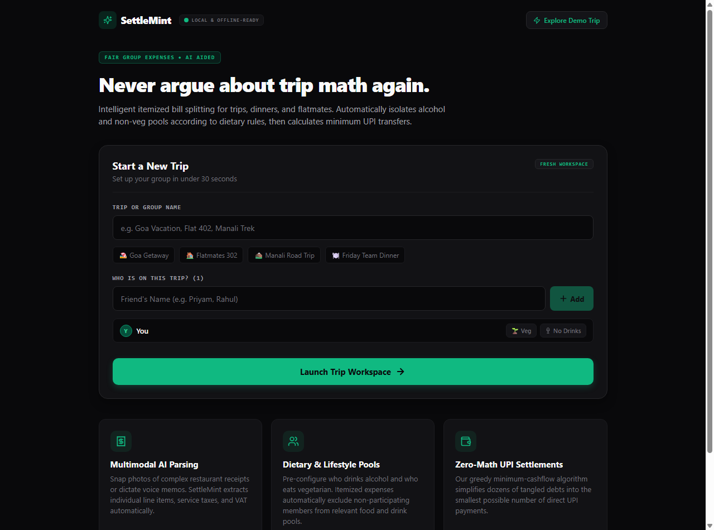
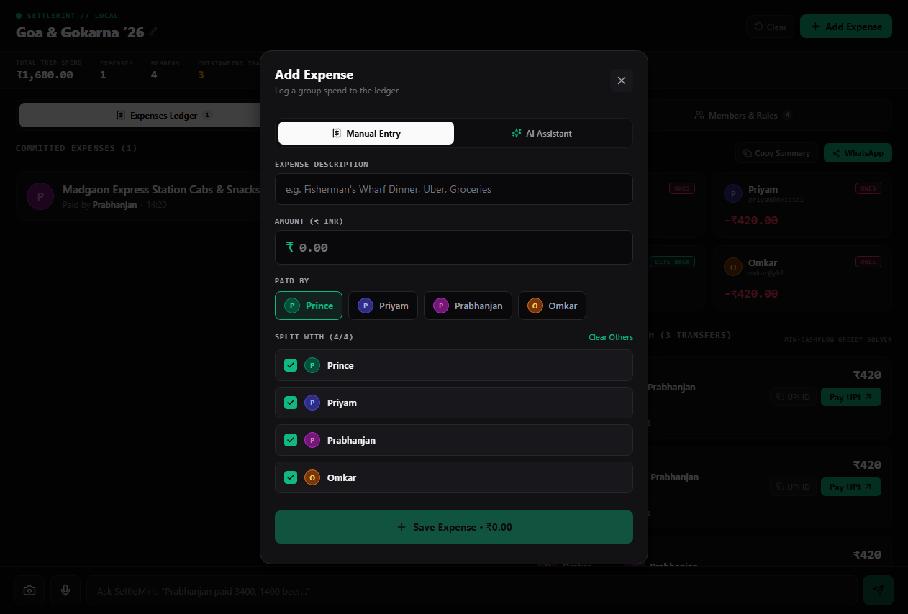
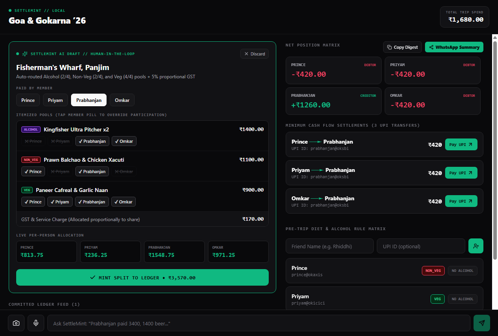
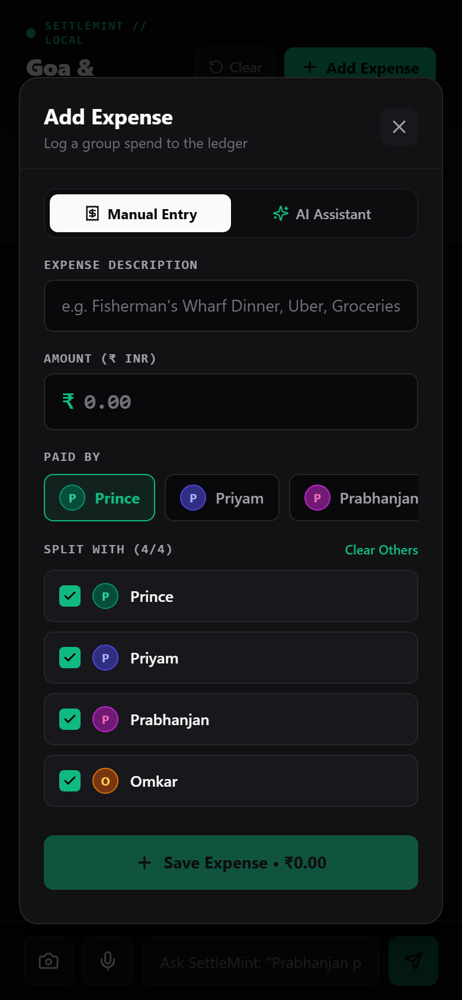

# 🍃 SettleMint

> **AI-Powered Group Trip Expense Splitter & Greedy Debt Minimizer**  
> Split group bills with dietary & alcohol exclusion rules, minimize circular debts, and settle instantly with universal UPI QR codes.

[](https://expo.dev)
[](https://reactnative.dev)
[](https://www.typescriptlang.org)
[](https://ai.google.dev)
[](https://supabase.com)
[](https://www.npci.org.in)

---

## 📸 Visual Showcase

### 1. Fresh Onboarding & Trip Setup
Create new trips with one-click presets (*"🏖️ Goa Getaway"*, *"🏠 Flatmates 302"*, *"🚗 Weekend Roadtrip"*), manage members, and configure dietary preferences (Veg, Non-Veg, Egg) and alcohol consumption rules upfront.

<p align="center">
  
</p>

---

### 2. Live Workspace & Ledger Dashboard
View group net balances in real time, see who is owed what, and browse an itemized feed of all expenses and repayments.

<p align="center">
  
</p>

---

### 3. Smart Expense Splitting & Exact Allocations
Add and edit expenses with ease. Choose between **Equal Split** or **Exact Custom Shares** with a live balance calculator that ensures every rupee is accounted for.

<p align="center">
  
</p>

---

### 4. Greedy Cashflow Minimization & Instant UPI Settlement
Reduces messy N-way debts down to the minimal possible payments ($O(N \log N)$). Tap **QR** on desktop or mobile to generate a scannable UPI QR code (`upi://pay`), copy the VPA, or tap **Settle** to record the repayment into the ledger.

<p align="center">
  
</p>

---

### 5. Mobile-First & Cross-Platform
Runs seamlessly across iOS, Android, and Desktop Web with responsive UI layouts.

<p align="center">
  
</p>

---

## ⚡ Core Features

- 🧠 **Dual-Model AI Parser**:
  - **Vision & Audio**: `gemini-3.5-flash` multimodal OCR extracts line items directly from camera receipt photos and audio voice memos.
  - **Text Command Bar**: `gemini-3.1-flash-lite` parses natural language commands (e.g., *"Rahul paid 3400, 1400 beer, rest veg"*).
  - **Offline Local Heuristic Engine**: Zero-API fallback that parses common splitting patterns completely offline with 0 token cost.
- 🥗 **Fair Exclusion Logic**: Automatically excludes non-drinkers from alcohol pools and vegetarian members from meat dishes based on preset group rules.
- 📉 **Greedy Min-Cashflow Algorithm**: Simplifies complex web debts into the fewest peer-to-peer repayments.
- 📱 **Universal UPI Settlement**: Deep links on mobile (`upi://pay?pa=...`) and dynamically generated QR codes on desktop for quick scanning via Google Pay, PhonePe, Paytm, or BHIM.
- 🔄 **Offline-First with Supabase Sync**: All state is cached locally via Zustand (`localStorage` on Web, `AsyncStorage` on native) and syncs to Supabase PostgreSQL when online.
- ✏️ **Full Transaction Control**: Edit past expenses, adjust split shares, and track completed repayments.

---

## 🛠️ Tech Stack

| Layer | Technology |
| :--- | :--- |
| **Framework** | [React Native](https://reactnative.dev) + [Expo 52](https://expo.dev) (Expo Router v4) |
| **Styling** | Modern dark-palette theme (`src/theme.ts`) with responsive desktop/mobile layouts |
| **State Management** | [Zustand](https://github.com/pmndrs/zustand) with custom offline storage adapter |
| **AI Models** | Google Gemini (`@google/genai`) — `gemini-3.5-flash` & `gemini-3.1-flash-lite` |
| **Cloud Database** | [Supabase](https://supabase.com) (PostgreSQL + Realtime publication) |
| **QR Generation** | `qrcode` for universal canvas / data-URL generation |
| **Icons** | `lucide-react-native` |

---

## 🚀 Getting Started

### 1. Prerequisites
- [Node.js](https://nodejs.org) (v18 or newer)
- npm or yarn

### 2. Installation
Clone the repository and install dependencies:
```bash
git clone https://github.com/R1NCwasUnavailable/SettleMint.git
cd SettleMint
npm install
```

### 3. Environment Setup
Copy the example environment file:
```bash
cp .env.example .env
```
Open `.env` and fill in your keys:
```env
# Supabase Configuration (Optional - offline storage works without it)
EXPO_PUBLIC_SUPABASE_URL="https://your-project-id.supabase.co"
EXPO_PUBLIC_SUPABASE_ANON_KEY="your-supabase-anon-key"

# Google Gemini AI Configuration (Optional - offline heuristic works without it)
EXPO_PUBLIC_GEMINI_API_KEY="your-gemini-api-key"
EXPO_PUBLIC_GEMINI_TEXT_MODEL="gemini-3.1-flash-lite"
EXPO_PUBLIC_GEMINI_MULTIMODAL_MODEL="gemini-3.5-flash"
```

### 4. Database Setup (Supabase)
If using Supabase:
1. Go to your [Supabase SQL Editor](https://supabase.com/dashboard).
2. Copy and run the contents of [`supabase/schema.sql`](supabase/schema.sql).

### 5. Start the Application
Run in the web browser:
```bash
npx expo start --web
```
Or start the interactive Metro dev server to test on iOS/Android via Expo Go:
```bash
npx expo start
```

---

## 📐 Project Structure

```
SettleMint/
├── app/                        # Expo Router navigation routes
│   ├── _layout.tsx             # App layout & root providers
│   └── index.tsx               # Main responsive ledger screen & landing gate
├── assets/
│   └── screenshots/            # App preview images
├── src/
│   ├── components/
│   │   ├── AddExpenseModal.tsx   # Add/Edit expense & custom split allocation
│   │   ├── CashFlowPanel.tsx     # Greedy settlement, UPI QR, and repayment ledger
│   │   ├── CommandBar.tsx        # Camera/Voice/Text input prompt bar
│   │   ├── DraftInspector.tsx    # AI parsed receipt confirmation card
│   │   ├── FreshLandingScreen.tsx# Trip creator & member preference rules
│   │   ├── LedgerFeed.tsx        # Transaction history feed
│   │   ├── RosterMatrix.tsx      # Group members list & balances
│   │   └── UpiQrModal.tsx        # Universal scannable UPI QR modal
│   ├── lib/
│   │   ├── cashflow.ts           # Greedy min-cashflow graph algorithm
│   │   ├── exportSummary.ts      # WhatsApp & text clipboard export
│   │   ├── gemini.ts             # Gemini AI multimodal & heuristic parser
│   │   └── supabase.ts           # Supabase client & sync helpers
│   ├── store/
│   │   └── useTripStore.ts       # Zustand offline-first persistent store
│   └── types/
│       └── ledger.ts             # TypeScript definitions
├── supabase/
│   └── schema.sql              # PostgreSQL schema & realtime config
├── .env.example                # Template for environment variables
└── README.md
```

---

## 📄 License
This project is open source and available under the [MIT License](LICENSE).
